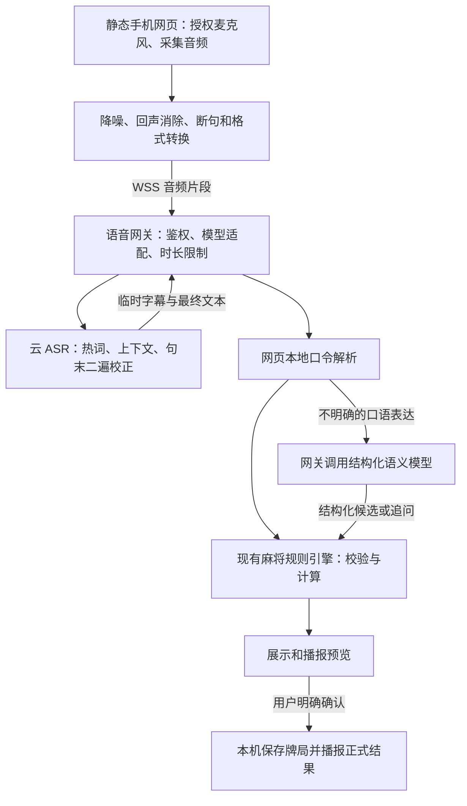

# v3 AI 语音识别增强设计

日期：2026-10-17（Asia/Shanghai）
状态：设计建议，尚未实施云语音接入。

## 1. 目标与现状

目标是在手机麻将牌桌中，更准确识别四位玩家昵称、杭州麻将胡法和两颗骰子的点数，并维持现有的结算确认流程。

当前 v3 使用浏览器 SpeechRecognition / webkitSpeechRecognition、前端口令解析和浏览器 speechSynthesis。现有规则引擎、语音对话状态及独立的 v3 牌局存储可继续使用。现有自动测试与模拟语音浏览器检查，不代表真实设备、真人口音或现场噪声下的识别准确率。

当前已核对：公网 /majiang/ 是 v3 页面，但使用普通 HTTP，HTTPS 443 连接未成功。HTTPS 是实际获取麦克风音频的接入前提，接入 AI 模型不会解除浏览器的安全上下文要求。

## 2. 推荐决策

采用：**静态网页 + 轻量语音网关 + 云端中文 ASR + 本地规则解析优先 + 按需结构化语义模型 + 现有计分引擎与播报。**

- 首选验证火山引擎豆包大模型流式语音识别，利用热词、对话上下文和句末二遍识别能力。
- 保留可替换的 ASR 适配接口。腾讯云实时 ASR 可作为对照候选；用同一套真实牌桌录音实测后决定默认服务，不预先宣称某家更准。
- 第一阶段直接使用云端模型 API，不在手机页面打包模型权重，也不要求现有服务器自行运行识别模型。
- 语义理解使用现有本地解析器处理明确口令；口语化纠错、否定与复杂表达才交给受约束的文本模型。
- 播报暂用浏览器 TTS。更换播报音色不会提高输入识别准确率，云 TTS 可以后续单独升级。
- 保持“点一次开始、分句对话、播报时暂停收音”。默认不加入唤醒词或后台常驻收音。

官方能力依据：

- [豆包大模型流式 ASR API](https://docs.volcengine.com/docs/DoubaoVoice/LargemodelstreamingautomaticspeechrecognitionAPI?lang=zh)：WebSocket 接口与 enable_nonstream 二遍识别；具体可用参数须与开通的接口版本核对。
- [热词与上下文](https://docs.volcengine.com/docs/DoubaoVoice/hot-words-and-context?lang=zh)：支持请求级热词和上下文；热词是提示，不保证强制正确，容量随识别模式不同而不同。
- [腾讯云实时 ASR](https://cloud.tencent.com/document/api/1093/48982)：候选服务，支持实时转写及热词配置。

## 3. 系统结构



静态产物仍由 nginx 提供。新增网关只负责语音及语义服务，牌局继续保存在浏览器。第一阶段不增加账户体系、牌局数据库或多设备同步。

建议服务路径：

- `/majiang/`：静态网页。
- `/api/voice/session`：创建短时语音会话，提供能力配置与使用额度。
- `/api/voice/ws`：同源 WSS 音频与识别结果连接，由网关连接云服务。
- `/api/voice/interpret`：可选文本语义解析。

HTTPS/WSS 在 nginx 终止，语音网关监听本机地址。云厂商密钥只在服务端环境变量或密钥存储中配置，不进入 HTML、JS 或 Git。网关需要访问口令换取短期会话、并发限制、单次录音时长上限及用量限制，避免公开接口被无成本滥用。

## 4. 提高准确率的具体措施

### 4.1 从收音质量开始

- 申请浏览器支持的回声消除、降噪与自动增益；具体效果要在目标手机验证。
- 用实际采集参数转换音频，不能只在请求里把 48 kHz 声音标为 16 kHz。
- 采用所选接口要求的音频格式。以当前核对的豆包接口为例，可用 16 kHz、单声道、16-bit PCM；前端可用 AudioWorklet 采集、重采样并分片。
- 语音活动检测用于切句，保留句首短缓冲，避免漏掉“不是”或昵称首字。停顿阈值先作为可调参数，依据实测修改。
- 开启对话后的环境闲聊仍可能被收到。只有完整、明确的牌局指令才进入预览；多人同时说话或语义冲突时要求重说。

### 4.2 动态热词

每次开场、修改昵称或修改胡法后，更新会话上下文：

- 当前四位玩家的昵称及允许使用的座位叫法。
- 本场开启的胡法，例如爆头、财飘、七对、清一色、十三不靠、碰碰胡。
- 当前正在等待的信息：两颗骰子、胡牌者、胡法、承包者或确认。
- 最近少量相关问答，不上传整场牌局历史。

词表按当前追问阶段排序并限制长度。例如正在问“谁胡了”时优先四个昵称，正在问胡法时优先本场启用的术语。遵守具体 ASR 模式的热词 token/词长限制，不把所有同义词和完整对话无限堆入词表。

### 4.3 先字幕，后终稿

- 中间识别结果可显示为临时字幕，不触发业务操作。
- 句末使用终稿；如当前模型/API 支持，开启流式加二遍识别，使整句话的上下文参与校正。
- 接口适配层必须区分“首遍分句结束”与“二遍修订后的终稿”。如果最终完成标记不明确，第一版改用流式输入、句末返回终稿的模式，禁止用一个固定延时猜测终稿到达。
- 每个句子绑定 utteranceId。终稿修订只替换当前候选，不重复执行同一条指令。

### 4.4 限定候选与澄清

- 胡牌者必须是本场四人之一；胡法必须属于本场已启用集合；每颗骰子必须为 1–6。
- “包头”“青衣色”可结合本场语境尝试映射为“爆头”“清一色”，同时显示原始识别文本与解析结果。
- 同音昵称存在多个候选时询问方位；不能靠模型自行选择。
- “我胡了”不默认等于下方；“八点”不伪造出两颗骰子；缺失字段必须追问。
- “不是阿福，是阿青”可以用文本模型抽取纠正后的玩家，但不让文本模型凭空补出未说的胡法、点数或承包关系。

## 5. 文本模型的边界

文本模型只在现有解析器无法明确处理时调用，输入包括：最终转写、本场玩家 ID/昵称、可用胡法、当前对话阶段和少量相关上下文。

输出必须通过 JSON Schema 校验，例如：

```json
{
  "intent": "preview_win",
  "winnerId": "player-right",
  "winTypeIds": ["baotou", "pureSuit"],
  "liablePlayerId": null,
  "needsClarification": false,
  "clarificationQuestion": null
}
```

这个结构不允许包含“最终得分”或“直接修改牌局”的操作。模型输出后仍由代码校验字段、玩家身份、启用状态、组合数量和承包关系。

**确认结算由前端固定指令与用户点击处理。** 模型不产生具有执行权的确认事件。确认必须绑定当前预览和当前局号；预览过期、规则或昵称变更、已结算、重连重复消息都不得再次记账。不采用模型自报的 confidence 数字作为自动记账依据。

## 6. 对话示例

### 骰子

1. 玩家：“三和五。”
2. ASR 终稿与解析结果：`dice = [3, 5]`。
3. 原有 getDealGuide 按当前庄家计算位置，助手播报具体方位、玩家名和数墩方法。
4. 页面保留发牌图；没有记分或改庄操作。

### 自然表达胡牌

1. 玩家：“不是小王，是开心果，七对加清一色。”
2. ASR 热词帮助识别名字和术语。
3. 规则无法明确处理否定纠错时，文本模型返回受约束的 preview_win。
4. 现有规则计算得分，助手说“开心果，七对加清一色，本局预计赢 X 分，无承包，确认吗？”
5. 玩家说“确认结算”，前端检查预览仍有效后保存，并播报正式结果。

### 听不清

1. 玩家口音或环境噪声导致两个昵称均有可能。
2. 助手说：“是上方的开心果，还是右方的开心福？”
3. 玩家回答方位后才生成结算预览。

## 7. 代码调整范围

现有文件：

- `v3/js/voice.js`：把识别实现抽成 provider；保留现有 TTS 和收音/播报互斥逻辑。
- `v3/js/voice-commands.js`：保留确定性的解析与字段限制。
- `v3/js/voice-app.js`：增加临时字幕/终稿、澄清、请求 ID 与预览版本控制。
- `v3/js/app.js`：继续通过 setDice、prepareSettlement、confirmSettlement 连接规则与界面。

建议新增：

- `v3/js/audio-capture.js` 和独立的 AudioWorklet：麦克风采集、格式转换及音频分片。
- `v3/js/voice-client.js`：同源会话、WSS 连接和识别事件适配。
- `services/voice-gateway/`：Node.js 语音网关，云 ASR/可选文本模型适配、使用限制与必要日志。
- `deploy/` 下的 nginx 配置示例及无密钥的环境变量模板。

AudioWorklet 默认作为单独静态资源构建，与 index.html 放在同一 dist 目录。v3 仍然是静态站点，但语音增强版不再把“单个 HTML 文件”作为硬性要求，以减少 Worklet 加载和 CSP 兼容问题。

## 8. 成本与数据

按查询时的[官方计费说明](https://docs.volcengine.com/docs/DoubaoVoice/Billinginstructions-21?lang=zh)，标准“大模型流式语音识别”后付费列价为 4.5 元/音频小时。假设实际计费音频为 10 分钟，ASR 约 0.75 元；这不包括文本模型、服务器等费用，也不代表连续开着三个小时只收十分钟。最终按所选具体服务、开通页面和实际账单核对。

第一阶段保留浏览器 TTS，只为 ASR 和少量复杂语句的文本理解付费。限制单句长度和空闲连接，统计送往服务的音频时长与账单用量。断网、额度耗尽或超时后停用云识别并保留手动/文字操作。

默认不保存原始录音。为了调优而保留测试录音时，需征得说话者同意并设置删除期限；服务日志默认只保留请求状态、耗时、用量与错误类别。页面说明音频会发往所选云服务。

## 9. 实施次序与验收

### 第一步：真实收音链路

- 完成有效 HTTPS 和同源语音网关部署。
- 用本人手机验证授权、录到声音、音频格式和 ASR 终稿。
- 提供“按住说话/短句录音”的测试模式，便于先隔离连续收音的问题；正式入口继续支持点一次开启的会话模式。

### 第二步：牌局识别增强

- 接入动态昵称/麻将热词和当前追问上下文。
- 实现句末二遍校正或终稿模式。
- 连接现有骰子和结算预览，不改变计分规则。

### 第三步：语义与质量评估

- 对规则处理不明确的口语表达启用受约束文本模型。
- 用同一批录音对比浏览器识别与云 ASR；必要时比较第二家服务。
- 收集 100–200 条经过同意的真实短句，覆盖不同玩家、安静/洗牌声/环境闲聊、不同手机及口音；调参集与验收集分开。
- 衡量玩家、胡法、骰子字段的完全正确率、需要追问的比例、错误指令进入预览的比例、误记账次数及端到端延迟。不能只看中文字错误率。

初始验收目标（待真实样本验证，不是已达到的结果）：

- 安静环境关键字段完全正确率 ≥95%。
- 一般牌桌噪声环境关键字段完全正确率 ≥90%；无法确定时能澄清。
- 验收集中的否定、闲聊、重复消息和过期确认不导致误记账。
- 普通短口令从说完到首个有效回复的 P95 目标 ≤2.5 秒；复杂语义场景单独统计，依据实际网络与模型耗时调整。

目前不承诺特定服务在牌桌上的实测准确率，也不以现有模拟语音测试代替真人设备验收。先做热词、音频和上下文调优；只有保留测试集持续暴露系统性错误时，再评估自托管模型或模型微调的投入。
